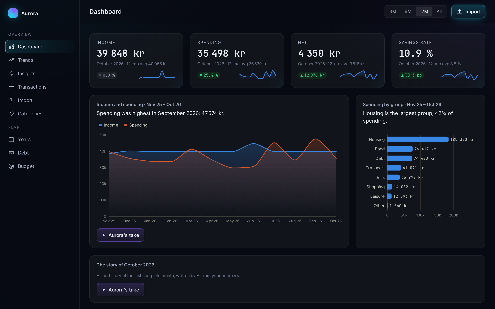
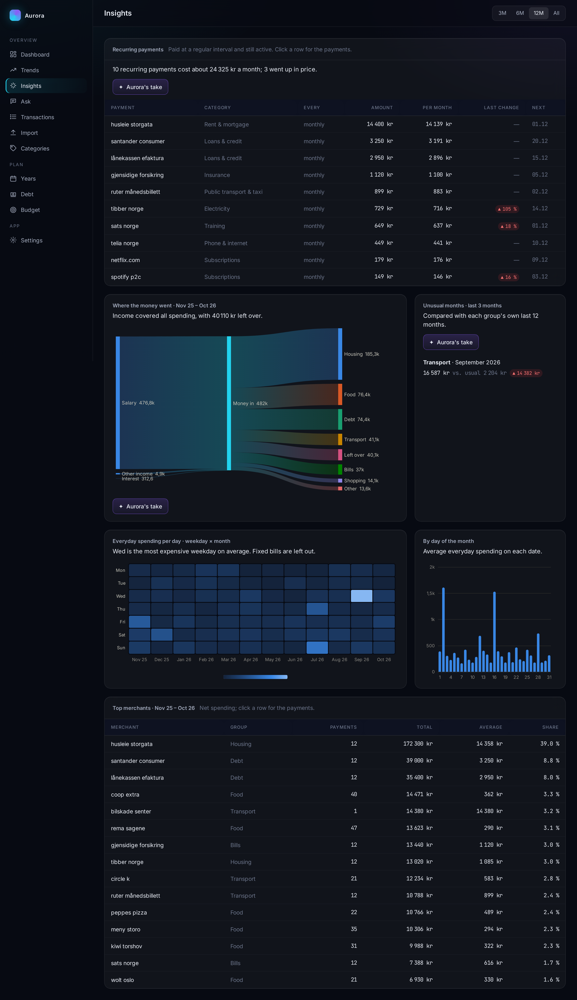
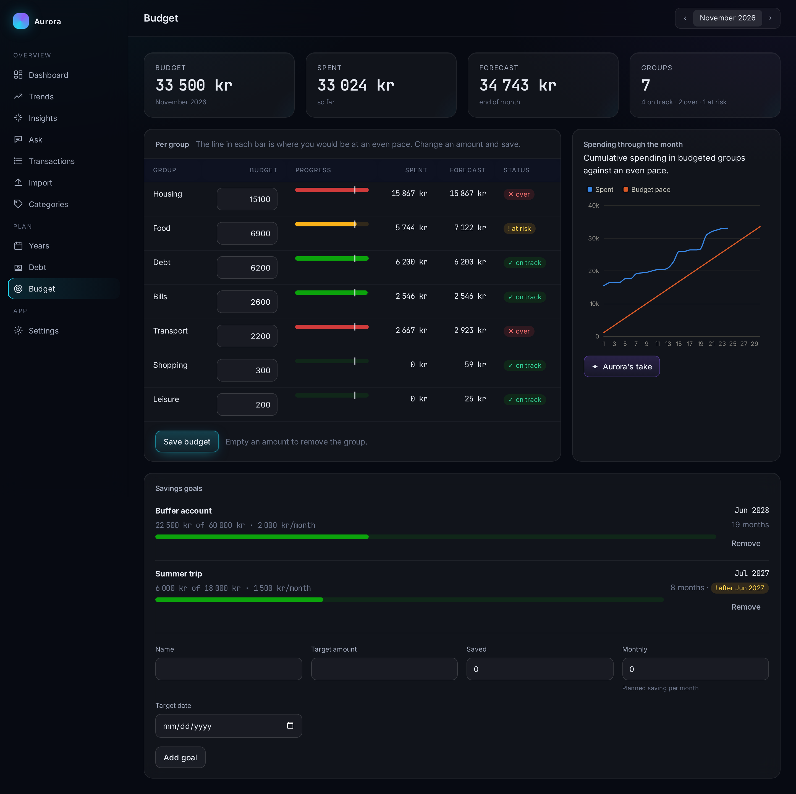
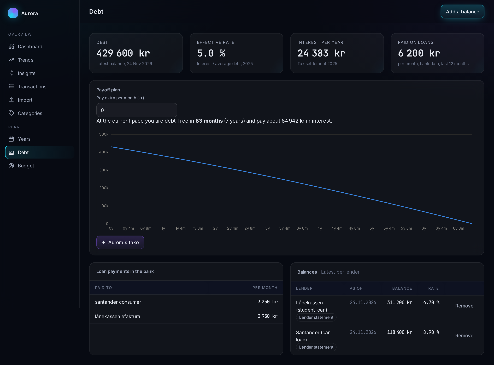
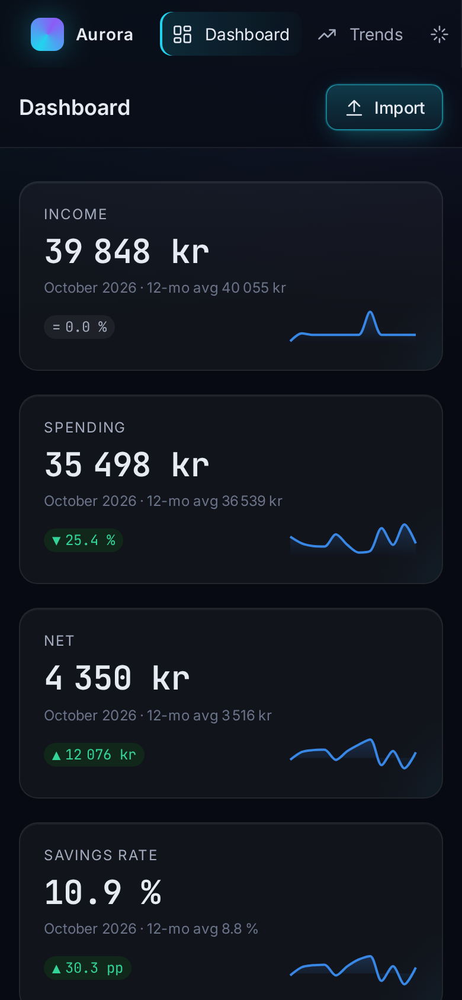
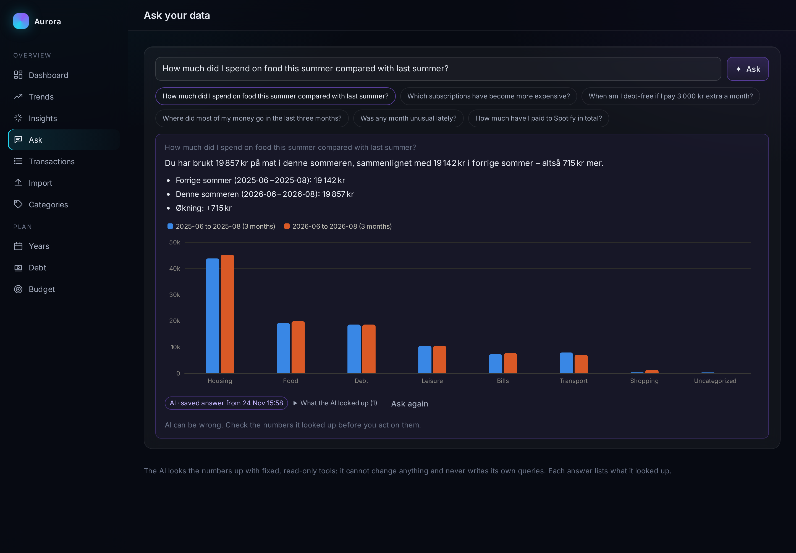
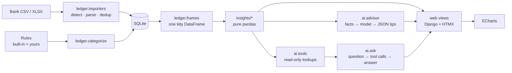

# Aurora Finance

[](https://github.com/LordBalouch/aurora-finance/actions/workflows/ci.yml)

A personal finance app that turns raw bank exports into answers. It imports CSV and Excel
files, sorts every transaction into a category, and shows where your money goes. It also
finds subscriptions and price rises, flags unusual months, plans a budget and a debt payoff,
and can explain your numbers in plain language with AI.

I built it for my own finances, and as a data-analysis project. It runs locally, and your bank data never leaves your machine.

> Every number in the screenshots is **synthetic**, generated by `make demo`.



## What it does

| | |
|---|---|
| **Import** | CSV and XLSX exports from Norwegian banks (DNB, Nordea, SpareBank 1, Bank Norwegian, Revolut and others with similar columns). An unknown layout asks once which column is which, and remembers it. Re-importing an overlapping file adds nothing, and any import can be undone. |
| **Categorize** | About 250 built-in rules for Norwegian merchants, plus your own rules. An inbox lists whatever is still uncategorized. |
| **Dashboard** | Income, spending, net and savings rate, each compared with the previous month and the 12-month average. Click any bar to see the transactions behind it. |
| **Trends** | Spending per group month by month, fixed against variable costs, and small multiples on one shared scale. |
| **Insights** | Recurring payments and price rises, unusual months, a Sankey diagram of where the money went, and spending by weekday and by day of month. |
| **Budget** | A budget suggested from your history, progress against an even pace, an end-of-month forecast, and savings goals with a projected date. |
| **Settings & backup** | Choose the AI, download the whole database as one file, and restore it (the current data is copied aside first). |
| **Years & debt** | Figures from the yearly tax settlement, the effective interest rate, and a payoff plan that shows what paying extra each month would save. |
| **Ask your data** | Ask a question in plain language. The AI answers by calling fixed, read-only analysis tools, and shows a chart and every lookup it made. |
| **Aurora's take** | AI advice on every analysis card, from Claude, a local model or any OpenAI-compatible API. The model gets only the numbers the card shows, and you can see exactly which numbers it was given. |

| Insights | Budget |
|---|---|
|  |  |
| **Debt** | **Mobile** |
|  |  |



## Quick start

You need Python 3.13. Everything else comes from `pip`.

```bash
git clone https://github.com/LordBalouch/aurora-finance.git && cd aurora-finance
python3 -m venv .venv && .venv/bin/pip install -r requirements.txt
make demo        # builds a synthetic demo database → http://localhost:8012
```

To use it with your own data:

```bash
make migrate && .venv/bin/python manage.py seed_categories
make dev         # http://localhost:8010 → Import
```

`make demo` writes to `data/demo.sqlite3` and refuses to run against a database that
already has transactions, so it can never mix synthetic rows into real data.

### AI (optional)

Every feature except the AI ones works from your files alone. For Aurora's take and Ask your
data, pick one provider on the **Settings** page (or in `.env`, see `.env.example`). Keys are
stored in a local file readable only by you, and a "Test the saved AI" button checks them.

| Provider | Setting | Notes |
|---|---|---|
| Claude (recommended) | `ANTHROPIC_API_KEY=...` | Best answers. Only the numbers a card shows, or the results of the lookups, are sent. |
| Local model | `AI_PROVIDER=ollama` | Free, and nothing leaves your machine. Run `ollama pull qwen3:8b` first; with 24 GB of memory or more, `OLLAMA_MODEL=gpt-oss:20b` reads numbers better. Answers take up to a minute. |
| Any OpenAI-compatible API | `AI_PROVIDER=openai`, `OPENAI_BASE_URL`, `OPENAI_API_KEY`, `OPENAI_MODEL` | OpenAI, Gemini, Mistral, LM Studio and others. |

## The analysis as a notebook

[`notebooks/analysis.ipynb`](notebooks/analysis.ipynb) walks through the analysis step by
step on synthetic data: data quality, money flows, recurring payments (including a false
positive and why it happens), robust against naive anomaly detection, a median-based budget
and the payoff of extra loan payments. It renders on GitHub. To run it again yourself:
`pip install -r requirements-notebook.txt && python scripts/build_notebook.py`.

## Architecture



- **`ledger/`** holds the models, the importers (with format detection and duplicate
  fingerprints), the rule-based categorizer and the demo generator.
- **`insights/`** is the analysis code. It is pure pandas with no Django, and every
  function takes a DataFrame and returns one. That makes it easy to test, and it is most of
  the test suite.
- **`web/`** contains thin Django views that call `insights` and pass the result to the
  templates. It uses HTMX for in-place updates and hand-written CSS on design tokens, with
  no JavaScript build step.
- **`ai/`** holds the AI features. `advisor` builds a fact sheet from numbers computed on the
  server and asks for structured JSON (summary plus tips). `ask` runs a tool-use loop over
  `tools`: nine read-only functions on top of `insights`, with checked arguments. `providers`
  speaks to Claude, Ollama or any OpenAI-compatible API. Answers are cached by the exact
  request.

## Analysis methods

- **Money flows.** Every transaction is income, spending, a transfer between your own
  accounts, or a netted item such as money between friends. Transfers never count as
  spending, and refunds lower spending instead of counting as income.
- **Complete months only.** The current month and thin leading months (fewer than 20 % of
  the median number of transactions) are left out of averages and trends.
- **Recurring payments.** A merchant counts as recurring when at least 70 % of the gaps
  between payments are within ±35 % of the median gap, and that gap matches a weekly,
  monthly, quarterly or yearly cadence. When one merchant has several payments (two loans
  at the same bank, for example), each amount level is tested on its own. A price change is
  the last payment compared with the median of the earlier ones.
- **Anomalies.** Each group's spending in the last three months gets a robust z-score
  (median and MAD × 1.4826) against that group's previous 12 months. Small amounts and
  short histories are ignored.
- **Month forecast.** Spending so far, plus recurring payments still due this month, plus
  the typical other spending for the days that are left.
- **Budget suggestion.** The median of the last six months per group, rounded up to the
  nearest 100 kr. A month with no spending in a group counts as 0, so one rare cost does
  not inflate the budget.
- **Debt payoff.** A month-by-month annuity simulation, checked against the closed form
  `n = −ln(1 − rB/P) / ln(1 + r)`. Extra payments go to the loan with the highest rate
  (the avalanche method), and when a loan is paid off, its payment moves to the next one.

## Tests and quality

```bash
make test        # pytest, about 150 tests
make cov         # coverage per module: 97 % in total, 96–100 % in insights/
make lint        # ruff
```

CI runs lint and tests on every push. The AI tests use a fake client, so they never call
the API. `scripts/screenshots.py` opens every page in Playwright and fails on any browser
console error.

Key decisions and why: [docs/decisions.md](docs/decisions.md).

## Privacy

Real bank files and the real database live in `data/`, which is gitignored. Everything in
this repository, including tests, screenshots and this README, uses synthetic data only.

## License

MIT, see [LICENSE](LICENSE).
